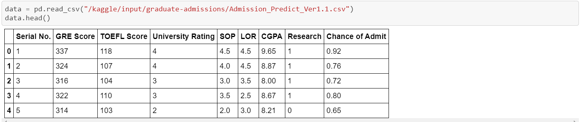
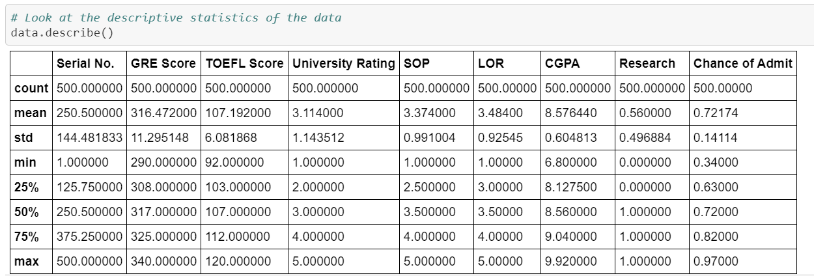
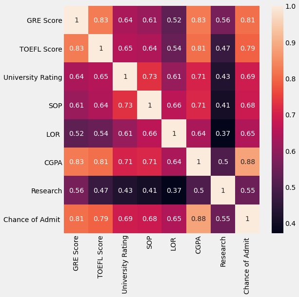
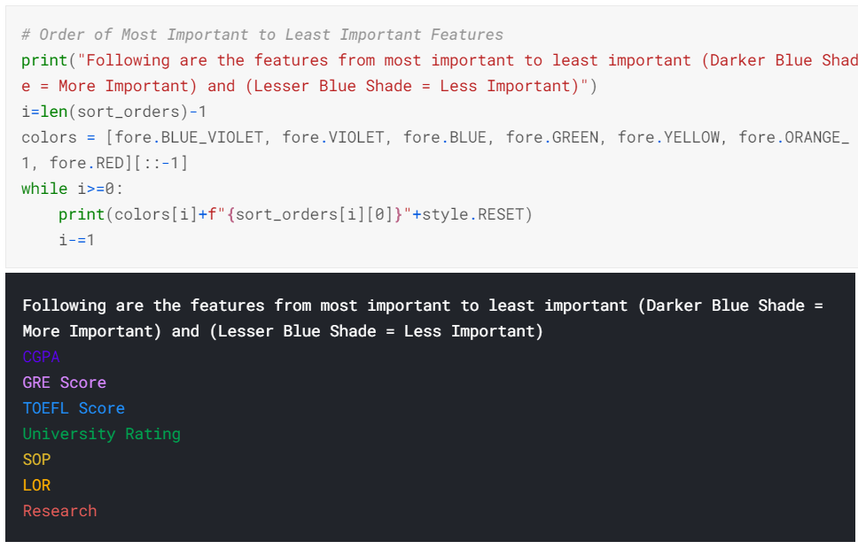
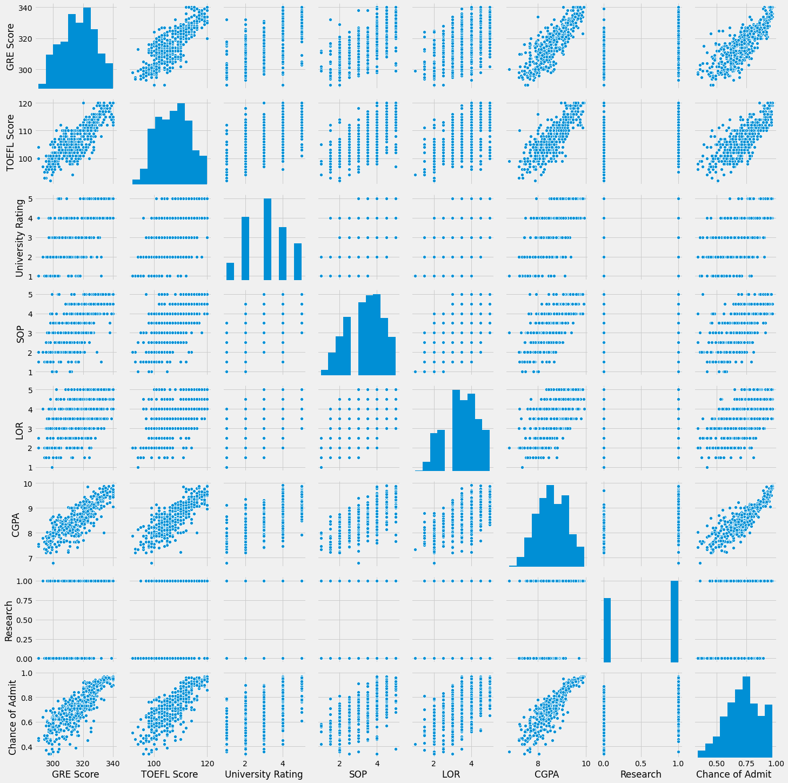
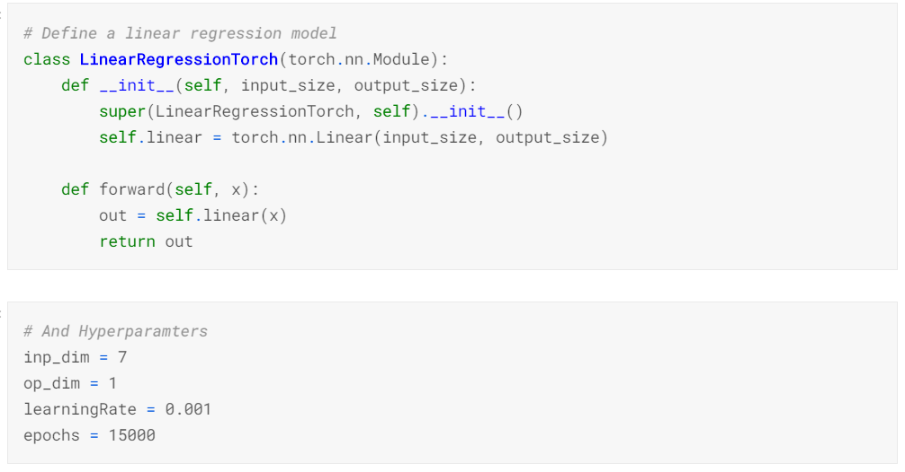
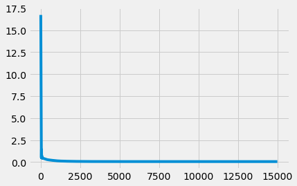
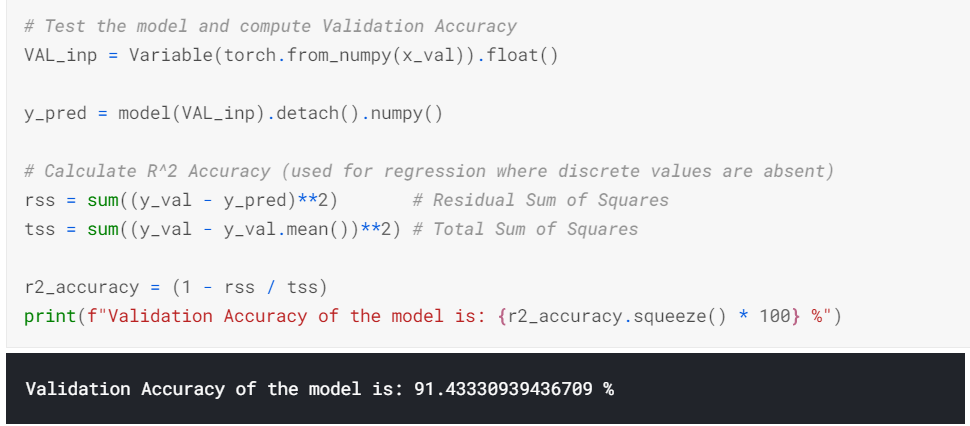

# Introduction

In the last few years, the number of students opting for a Graduate Degree (also called a Master's Degree) has seen an increase. Whether it be for further education, better career options, immigrating to other countries and even research, the number increases as new opportunities and prospects keep opening.

As someone who personally is preparing for Graduate level studies, I thought it would'be a good idea to do some analysis on the same.

For this purpose, I found an excellent dataset on Kaggle: [Graduate Admission 2](https://www.kaggle.com/mohansacharya/graduate-admissions) (For Citation, jump to end of the article).

This dataset is created for prediction of Graduate Admissions from an Indian perspective. But even if you are not an Indian, it would still hold true as most of the colleges in Europe and USA have slim to none reservations/changes when viewing student applications based on their country of origin.

**Note: I have not shown full code for any analysis here, If you want to see the code, here is the  [Notebook I made](https://www.kaggle.com/heyytanay/college-admission-analysis-eda-models).**

## Data
The dataset is fairly small, consisting of ~500 entries, none of them being NULL/NaN. The Dataset consists of 9-columns, out of which only 8 are actually useful (as Column: `Serial No` has no significance)

The Feature `Chance of Admit` has the probability of a certain student getting selected at a University/College.

Our task for today is to analyze the relationship between various features and with the `Chance of Admit` column. We will also build a Simple Linear Regression Model. **Remember**, this is a regression task as we have to predict the probability of being admitted to a college which is a continuous (ex: 0.1% to 100%, with every possible value in between) and not discrete (ex: 1,2,3, etc just some finite number of values).

You can take a look at the data below;

Here is a quick overview of the features;

* [GRE](https://en.wikipedia.org/wiki/Graduate_Record_Examinations) Scores (out of 340)
* [TOEFL](https://en.wikipedia.org/wiki/Test_of_English_as_a_Foreign_Language) Scores (out of 120)
* University Rating (out of 5)
* [Statement of Purpose (SOP) and Letter of Recommendation (LOR)](https://www.quora.com/What-is-SOP-and-LOR-and-how-to-build-it-more-effectively#:~:text=k%20answer%20views-,SOP%20is%20Statement%20of%20Purpose%20and%20LOR%20is%20Letter%20Of,motivated%20to%20complete%20the%20program.) Strength (out of 5)
* Undergraduate GPA (out of 10)
* Research Experience (either 0 or 1)
* Chance of Admit (ranging from 0 to 1)

## Data Visualization
Now that we know what the data looks like, it would be a good time to start understanding and visualizing it.

#### Descriptive Statistic of Data
A descriptive statistic is a summary statistic that quantitatively describes or summarizes features from a dataset.

We can get a lot of information from the descriptive statistic of the dataset such as it's mean, median, minimum, maximum. 25%, 50% and 75% Quantiles.

*Pssh! What is this Quantile thingy?*: Yeah, Watch this video: 

Otherwise, I will be explaining what %-Quantiles (Percentiles) mean in this context down below.

We have observed a few things from the description above;

* Students in this dataset had a minimum chance of **34%** and a maximum of **97%** of getting selected
* *75%* of students had less than **82%** chances of getting selected.  
* *50%* of students in the data had less than **72%** chances of getting selected.
* On an average a student had **8.5** GPA (out of a maximum 10). In this, 75% of all students have less than 9.0 GPA and 50% of the students have less than 8.5 GPA.
* Also, the minimum present GPA present is **6.8** and the maximum present is **9.9**
* SOP, LOR and University Rating Descriptives are fairly straight forward and you can take a look at them yourself below
* Maximum TOEFL Score is **120** and minimum is **92**. Of this, *75%* of all students have less than 112 score in TOEFL and 50% of the students have less than 107 score. On an average the student has 107 score.
* Maximum GRE Score is **340** and minimum is **290**. Of this, *75%* of all students have less than 325 score in GRE and 50% of the students have less than 317 score. On an average the student has 316 score.

In the above points I have described the concept of percentiles and you didn't even noticed! Let's take the first point as the example. The *75th* Percentile of the Chances of Getting Selected is *0.82*. 
**What that means is that 75% of all the entries in the dataset has less than 82% chance (also written as 0.82) of getting selected**. If you still haven't understood it, I recommend going to the above provided video to understand it better. 

If you read the above points carefully and tried to make sense of it, you will have a very clear image of the dataset and how many students actually get selected among other things.

But that isn't all, in-fact the most important thing is yet to come. 

#### Heatmap of Feature Correlation

A heatmap in this context is basically a visualization that tell us about the correlation between all the different features in the data. 

*What is correlation?*: In the simplest sense, Correlation between two variables tells us how are they related to each other (you can also say, how they affect each other).

For example, If 2 variables x and y have a correlation coefficient of 1, then x proportional y (if x increases, so does y).
If they have a correlation of -1, then they are negatively proportional to each other. (if x increases, y would decrease).

So here is the heatmap of the correlation of features;

A few questions you might have:

1. Why are the diagonal values all 1?: It's simple, a variable x would always have a correlation of 1 with itself. In other words, you would be 100% like yourself, right?
2. What is the color scheme suggesting?: In the heatmap, if 2 variables are less correlated, they have their cell more darker and vice-versa.

If you still don't understand a Heatmap, don't worry. Just look at the few very important observations below;

**CGPA has a correlation coefficient of 0.88 meaning that CGPA is the most correlated to Chances of Getting Selected at a college (sorry, 7 GPA gang 😭).**

**On the other hand, Research is the least correlated to Chances of getting Selected with a coefficient of 0.55**.

In-fact, we can arrange all the features in descending order of their importance to getting selected.

Here is what that looks like:

As you can now see, `CGPA`, `GRE Score` and `TOEFL Score` are the three most important features that gives more probability that a candidate will get selected.

#### Pairplot of Data
Finally, let's also make a pairplot of the dataset.
A pairplot is a just a bunch of plots that shows the relation between every pair of variables (basically the plots of all the combinations of the data features).

If you don't undertand what this is, don't worry, it'll start making sense to you once you start practicing data science.

## Modelling and Training
Now that the Data Visualization is over, let's quickly compare 2 approaches to make a Linear Regression Model I used.

#### Splitting the Data

I have split the complete data into 4 parts;
x_train, y_train, x_val, y_val.

Both train ones are used for training the model and the val ones are used for testing the model.

The val ones have about 5% of the total data.

#### Approaches 

1. I used PyTorch to make a custom Linear Regression model by defining everything and specifying each step before hand. This approach is good when you have complex model architecture to implement and no-external support from any library can be found.
Here is a quick glimpse of that;

2. In the second approach, I used the scikit-learn class `LinearRegression` for training the model.

#### Training

In the PyTorch approach, after training for 15K epochs, my Loss Graph looked like this;

#### Validation Accuracy
Since the PyTorch approach used everything custom, I have implemented R2 Accuracy.

R2 accuracy already is available as a function in the scikit-learn library, so I just used it.

Comparing Validation accuracy from both approaches;

<table>
    <tr>
        <th>Approach</th>
        <th>Accuracy</th>
    </tr>
    <tr>
        <td>PyTorch</td>
        <td><i>91.43%</i></td>
    </tr>
    <tr>
        <td>Scikit-learn</td>
        <td><i>91.87%</i></td>
    </tr>
</table>

As you can see there isn't a lot of difference but there you have it.

For more technical details on how I did the above things, see the notebook [here](https://www.kaggle.com/heyytanay/college-admission-analysis-eda-models).

# Conclusion
From this study we can conclude a few things;

* `CGPA`, `GRE Scores` and `TOEFL Scores` are most important for you to get selected at a good graduate school (at-least that's what the dataset suggested)
* `Research` is not as much important for getting selected. I'm not saying it's completely useless, but more like a low-priority.
* Statistics is cool af.

Please keep in mind that all the observations and conclusions are based on the dataset I used, and so the reality may differ but the observations from this very dataset will not (or so I think).

Citation: **Mohan S Acharya, Asfia Armaan, Aneeta S Antony : A Comparison of Regression Models for Prediction of Graduate Admissions, IEEE International Conference on Computational Intelligence in Data Science 2019**

Finally, I would like to end this article here. I hope you found it insightful. 
I am new to Machine Learning and Data Science in General and so If you found any mistakes/wrong assumptions and assertions, please correct them by messaging me on any of the social media platforms (Links at the footer).

--Tanay Mehta
